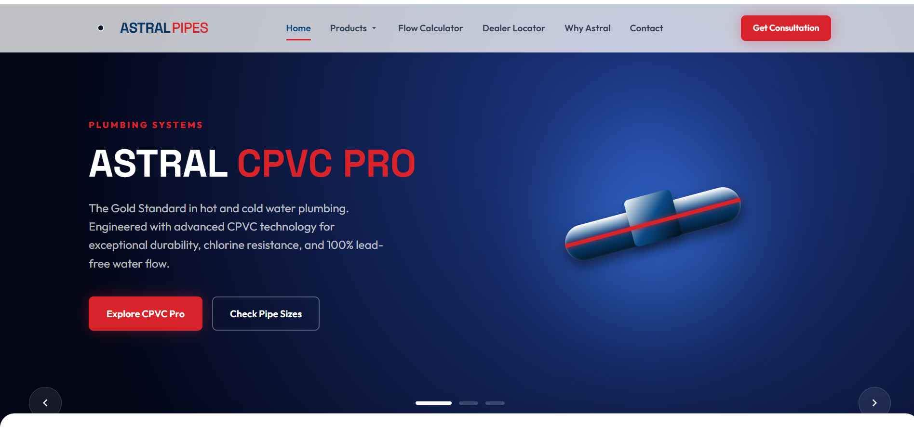
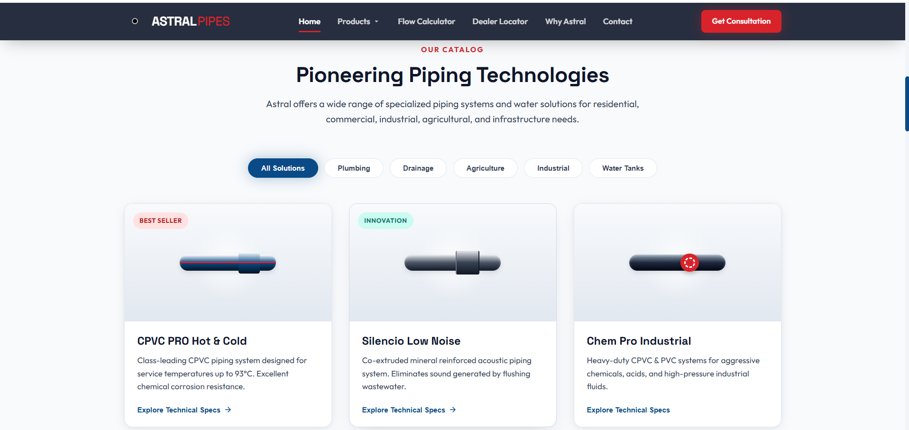
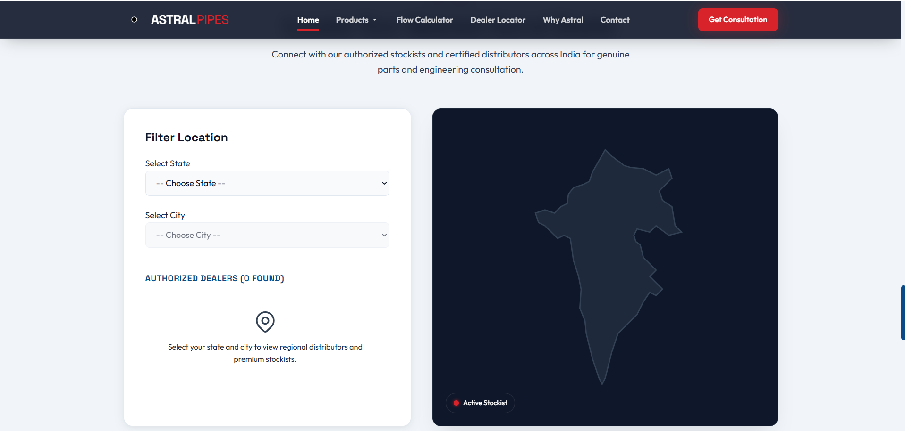
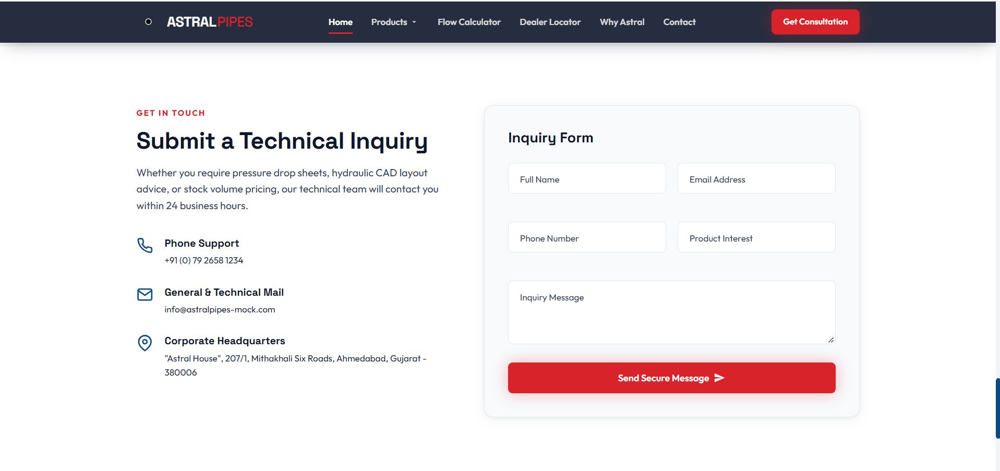

# 💧 Astral Pipes - Premium Piping & Water Solutions

<p align="center">
  
</p>

<p align="center">
  
  
  
  
  
</p>

A modern, responsive, and feature-packed web application for **Astral Pipes** showcasing cutting-edge piping systems, water storage solutions, dealer networks, and real-time hydraulic engineering calculators.

---

## 📑 Table of Contents

- [Overview](#-overview)
- [📸 Screenshots Showcase](#-screenshots-showcase)
  - [1. Hero & Home Section](#1-hero--home-section)
  - [2. Interactive Product Catalog](#2-interactive-product-catalog)
  - [3. Hydraulic Pipe Sizing & Flow Calculator](#3-hydraulic-pipe-sizing--flow-calculator)
  - [4. Interactive Dealer Locator](#4-interactive-dealer-locator)
  - [5. Technical Inquiry & Contact](#5-technical-inquiry--contact)
- [✨ Key Features](#-key-features)
- [🛠️ Tech Stack](#️-tech-stack)
- [🧮 Engineering Formula & Calculation](#-engineering-formula--calculation)
- [📂 Project Structure](#-project-structure)
- [🚀 Quick Start / How to Run](#-quick-start--how-to-run)
- [📱 Responsive Design](#-responsive-design)
- [📄 License & Credits](#-license--credits)

---

## 🌟 Overview

**Astral Pipes** is a premier front-end web portal crafted with a premium glassmorphic dark aesthetic, interactive animations, and dedicated engineering utilities. It provides plumbing contractors, civil engineers, architects, and homeowners with a seamless platform to explore plumbing products, locate authorized distributors, and simulate hydraulic flow parameters.

---

## 📸 Screenshots Showcase

### 1. Hero & Home Section
> Dynamic multi-slide hero carousel highlighting flagship plumbing, drainage, and water storage technologies alongside live milestone counters.

<p align="center">
  
</p>

---

### 2. Interactive Product Catalog
> Comprehensive product gallery with category filter tabs (Plumbing, Drainage, Agriculture, Industrial, Tanks) and dynamic technical specification modals.

<p align="center">
  
</p>

---

### 3. Hydraulic Pipe Sizing & Flow Calculator
> Professional engineering utility utilizing the **Hazen-Williams Equation** to compute real-time fluid velocity, friction head loss, and pressure drops with instant velocity hazard alerts.

<p align="center">
  
</p>

---

### 4. Interactive Dealer Locator
> Dynamic distributor finder featuring state and city cascading selectors paired with an interactive vector India map indicating regional stockist hubs.

<p align="center">
  
</p>

---

### 5. Technical Inquiry & Contact
> Direct inquiry submission portal with custom floating-label inputs, consultation interest selection, and corporate headquarter details.

<p align="center">
  
</p>

---

## ✨ Key Features

- **🎠 Dynamic Hero Slider**: Interactive carousel with smooth transitions, custom pipe renders, auto-cycling, and pause-on-hover.
- **🏷️ Product Catalog with Live Filtering**: Filter products instantaneously by category without page reloads.
- **🔍 Technical Spec Modals**: Detailed popups showing pipe dimensions, temperature limits, pressure ratings, and standard certifications.
- **⚙️ Real-time Hydraulic Calculator**:
  - Live friction head loss (Hazen-Williams formula).
  - Velocity gauge with color-coded alerts (Erosion Hazard, Optimal Range, Sedimentation Risk).
  - Material roughness factor adjustments (CPVC, uPVC, HDPE, Galvanized Steel).
- **🗺️ Interactive Dealer Locator**:
  - State & city cascading dropdowns.
  - Interactive SVG map pins highlighting distribution hubs.
  - Quick contact details for local stockists.
- **📱 Fully Responsive**: Flawless glassmorphic UI optimized across mobile, tablet, and ultra-wide screens.
- **⚡ Vanilla Implementation**: Fast, zero-dependency lightweight code without bulky frameworks.

---

## 🛠️ Tech Stack

| Technology | Purpose |
| :--- | :--- |
| **HTML5** | Semantic structure, accessible markup, embedded SVG graphics |
| **CSS3** | Modern Glassmorphism, CSS Grid, Flexbox, custom variables, keyframe animations |
| **JavaScript (ES6+)** | DOM manipulation, slider controls, modal management, hydraulic formulas |
| **Google Fonts** | `Outfit` & `Space Grotesk` typography |

---

## 🧮 Engineering Formula & Calculation

The hydraulic calculator embedded in the project uses the empirical **Hazen-Williams Equation** for circular water pipes:

$$h_f = \frac{10.67 \cdot L \cdot Q^{1.852}}{C^{1.852} \cdot D^{4.87}}$$

Where:
- **$h_f$** = Head loss due to friction (meters of fluid)
- **$L$** = Total pipe run length (meters)
- **$Q$** = Volumetric flow rate ($m^3/s$)
- **$C$** = Hazen-Williams roughness coefficient (e.g., 150 for CPVC/uPVC, 140 for HDPE, 100 for Steel)
- **$D$** = Internal diameter of the pipe (meters)

Flow velocity is evaluated as:
$$V = \frac{4 \cdot Q}{\pi \cdot D^2}$$

---

## 📂 Project Structure

```bash
ASTRAL-PIPES/
│
├── index.html               # Main application entry point & layout
├── style.css                # Global stylesheet, design system & responsive rules
├── main.js                  # Application logic, slider, calculator & map interactivity
├── README.md                # Project documentation with visual showcase
│
├── home.png                 # Screenshot: Hero & Home landing section
├── catalog.png              # Screenshot: Product catalog & filter tabs
├── ENGINEERING UTILITY.png  # Screenshot: Hydraulic pipe flow calculator
├── location.png             # Screenshot: Dealer locator & interactive map
└── Contact.png              # Screenshot: Inquiry form & contact information
```

---

## 🚀 Quick Start / How to Run

1. **Clone the repository:**
   ```bash
   git clone https://github.com/your-username/astral-pipes.git
   cd astral-pipes
   ```

2. **Run locally:**
   - Simply double-click `index.html` to open it in your favorite web browser (Chrome, Edge, Firefox, Safari).
   - *OR* use VS Code **Live Server** extension:
     - Right-click `index.html` → Select **Open with Live Server**.

---

## 📱 Responsive Design

The interface adapts smoothly to all viewport sizes:
- 💻 **Desktop & Large Displays** (1200px+)
- 💻 **Laptops & Tablets Landscape** (992px - 1199px)
- 📱 **Tablets & Mobile Landscape** (768px - 991px)
- 📱 **Mobile Devices** (< 768px)

---

## 📄 License & Credits

- Designed & developed for educational and portfolio demonstration purposes.
- Inspired by **Astral Limited**, leaders in innovative piping and water management systems.
